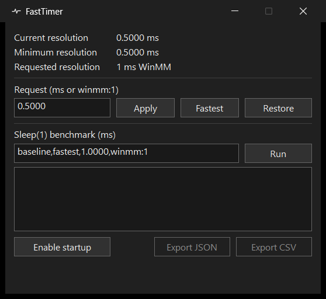

# FastTimer

**A Windows 11 utility for timer-resolution requests and repeatable `Sleep(1)` measurements.** Built with Rust and Win32, FastTimer reports the system timer interval, its own request, and measured wake-up times separately.

[Download for Windows](https://github.com/wannasly/FastTimer/releases/latest) · [Windows CI](https://github.com/wannasly/FastTimer/actions/workflows/windows.yml) · [Документация на русском](README.ru.md)



## Install and try it

The Windows 11 x64 release provides a per-user installer, a portable ZIP, a standalone CLI, and SHA-256 checksums. The binaries are unsigned. Compare a file's hash with `SHA256SUMS.txt` using `Get-FileHash -Algorithm SHA256`.

In the GUI, **Fastest** requests the shortest interval reported by Windows. **Apply** accepts a Native interval such as `0.5100` ms or a WinMM period such as `winmm:1`. **Restore** releases FastTimer's request. The tray provides background control and an explicit exit command. Startup is opt-in through a shortcut in the current user's Startup folder.

From a folder containing the CLI:

```powershell
.\fasttimer-cli.exe status --json
.\fasttimer-cli.exe hold winmm:1 --seconds 10
.\fasttimer-cli.exe benchmark --cases 'baseline,fastest,winmm:1' --samples 200 --warmup 20 --rounds 3 --json .\sleep.json --csv .\sleep.csv
```

## What the benchmark measures

Each case applies its request in the same process that calls Win32 `Sleep(1)`. After warm-up, `QueryPerformanceCounter` measures elapsed time for each sample. The order rotates across rounds. JSON includes the raw measurements, while CSV summarizes each case. The benchmark measures scheduler wake-up behavior under the current machine and workload. Input latency and frame rates are outside its measurement scope.

The [cross-process script](scripts/Test-CrossProcess.ps1) compares an independent process with visible and hidden request holders. The [Russian guide](README.ru.md#как-читать-измерения) explains the statistics, process visibility, and Windows timer behavior in more detail. See [research notes](RESEARCH.md) for methodology and past observations.

## Build and test

Use Rust stable targeting `x86_64-pc-windows-msvc`, Visual Studio Build Tools with Desktop development with C++, and the Windows SDK.

```powershell
cargo fmt --all -- --check
cargo clippy --locked --all-targets -- -D warnings
cargo test --locked
cargo build --release --locked
```

Cargo builds `fasttimer.exe` and `fasttimer-cli.exe` under `target/release/`. Install Inno Setup 6.3+ and run `./scripts/Build-Release.ps1` to build the distribution under `target/distribution/`. Windows CI builds the distribution and smoke-tests installation, CLI use, and removal.

- [Timer requests](src/timer.rs) pair Native and WinMM calls with RAII cleanup.
- [Benchmark](src/benchmark.rs) handles sampling, statistics, and JSON/CSV export.
- [Win32 UI](src/gui/) implements the window, tray, benchmark worker, and per-user startup.
