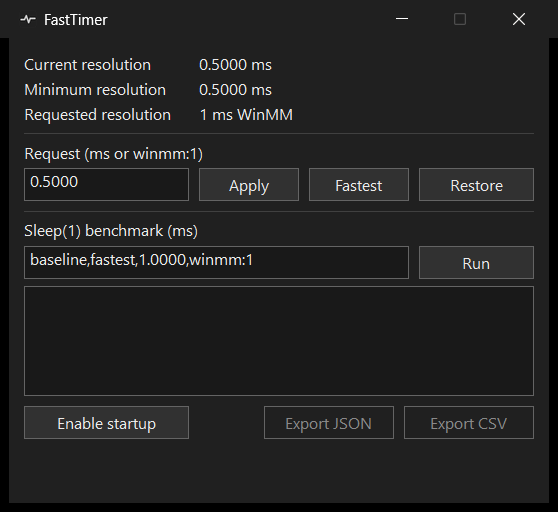

[English documentation](README.md)

# FastTimer

[](https://github.com/wannasly/FastTimer/releases/latest)
[](https://github.com/wannasly/FastTimer/actions/workflows/windows.yml)

Компактная утилита на Rust и Win32 для управления разрешением таймера и измерения `Sleep(1)`. Показывает системный интервал, запрос FastTimer и измеренное время пробуждения отдельно.



## Скачать для Windows 11 x64

| Файл | Для чего |
| --- | --- |
| **Установщик EXE** | GUI и CLI в папке текущего пользователя. Ярлык FastTimer и удаление через меню «Пуск». |
| **Portable ZIP** | GUI и CLI для запуска из любой папки. |
| **Standalone CLI** | Один `fasttimer-cli.exe` для терминала и скриптов. |
| **SHA256SUMS.txt** | Проверка скачанных файлов через `Get-FileHash -Algorithm SHA256`. |

[Открыть последний релиз](https://github.com/wannasly/FastTimer/releases/latest)

Установщик поддерживает русский и английский языки. Автозагрузка включается отдельно из окна FastTimer. Удаление сохраняет пользовательские настройки. Сборки распространяются без цифровой подписи.

## Сборка

Нужны Windows 11, Rust stable с целью `x86_64-pc-windows-msvc`, Visual Studio Build Tools с компонентом Desktop development with C++ и Windows SDK. Сборка проверена на Rust 1.97.1.

```powershell
cargo build --release --locked
cargo test --locked
cargo clippy --locked --all-targets -- -D warnings
cargo fmt --all -- --check
```

В `target\release` появятся два самостоятельных файла. `fasttimer.exe` открывает окно или работает в трее. `fasttimer-cli.exe` предназначен для терминала, конвейеров и сценариев.

Для подготовки установщика, portable ZIP и файла контрольных сумм установите Inno Setup 6.3+ и запустите `.\scripts\Build-Release.ps1`. Готовые файлы появятся в `target\distribution`. GitHub Actions выполняет проверку кода, сборку и тест установки и удаления. Пуш тега `v<версия>`, совпадающего с версией в Cargo.toml, публикует эти же артефакты в GitHub Releases.

## Окно и автозапуск

- **Fastest** запрашивает кратчайший интервал, который вернула Windows. Для **Apply** введите интервал Native в миллисекундах, например `0.5100`, или период WinMM, например `winmm:1`. **Restore** освобождает запрос FastTimer. Текущее значение Windows может остаться прежним, если действуют другие запросы.
- Кнопка закрытия скрывает окно в область уведомлений. В меню значка есть открытие окна, выбор кратчайшего интервала, освобождение запроса и выход. Выход также доступен через системное меню окна (`Alt+Space`).
- **Enable startup** создаёт `FastTimer.lnk` в папке автозагрузки текущего пользователя. Ярлык запускает FastTimer скрыто с запросом, активным в момент включения. Чтобы изменить этот запрос, выберите новый интервал, выключите и снова включите автозагрузку. Храните EXE по постоянному пути, на который указывает ярлык.
- В GUI бенчмарк берёт список режимов через запятую, выполняет три прохода по 100 замеров на режим и показывает сводку. Кнопки экспорта открывают диалог сохранения. Пока идёт тест, ручной запрос приостановлен. После завершения или отмены FastTimer восстанавливает его.
- Поля запроса и бенчмарка сохраняются в `%LOCALAPPDATA%\FastTimer\settings.json` после применения или запуска замера. При следующем открытии FastTimer заполняет поля, а начальный запрос по-прежнему задаётся через `--request` или ярлык автозагрузки.

```powershell
.\target\release\fasttimer.exe --hidden --request fastest
.\target\release\fasttimer.exe --hidden --request 0.5100
.\target\release\fasttimer.exe --exit
```

В сеансе Windows работает один экземпляр GUI. Повторный обычный запуск открывает его окно, а параметры первоначального запроса действуют при запуске нового экземпляра. Скрытый режим использует фоновый цикл сообщений для трея и останавливает периодический опрос окна. При завершении процесс освобождает свой запрос, в том числе при выходе из сеанса Windows.

## CLI

```powershell
$timer = '.\target\release\fasttimer-cli.exe'
& $timer --help
& $timer status --json
& $timer hold fastest --seconds 10
& $timer hold 0.5100
& $timer benchmark --cases 'baseline,fastest,0.5100,1.0000,winmm:1' --samples 200 --warmup 20 --rounds 3 --json .\sleep.json --csv .\sleep.csv
```

`hold` действует в процессе CLI до `Ctrl+C`, `Ctrl+Break` или конца заданного времени. `baseline` означает отсутствие собственного запроса, `fastest` использует минимум системы, число задаёт период для Native API, а `winmm:1` вызывает `timeBeginPeriod(1)`. В GUI фоновый режим можно остановить аргументом `--exit`.

## Как читать измерения

В каждом проходе FastTimer применяет один режим в том же процессе, где затем вызывает Win32 `Sleep(1)`. После разминки замеряет прошедшее время через `QueryPerformanceCounter`, записывает показания таймера перед серией и после неё и освобождает запрос. Порядок режимов циклически сдвигается между проходами. План, состояние Windows и частота счётчика сохраняются в отчёте.

JSON содержит все сырые измерения и наблюдения по проходам. CSV содержит одну сводную строку на режим. Поля `*_100ns` выражены в единицах 100 нс, остальные длительности с суффиксом `_ms` — в миллисекундах. P95 и P99 рассчитаны по ближайшему рангу. Стандартное отклонение использует делитель N, средняя абсолютная ошибка измеряется относительно 1 мс.

В схеме JSON 2 и в CSV также есть число выбросов за границами 1,5 межквартильного размаха, разница P99 и медианы и сумма измеренных ожиданий. Сумма исключает прогрев и время между замерами.

Для межпроцессного теста закройте окно и завершите FastTimer через меню трея. Затем запустите `.\scripts\Test-CrossProcess.ps1` в интерактивном сеансе. Скрипт сохраняет отдельные отчёты в `target\cross-process` для собственного запроса, внешнего видимого и скрытого держателя и проверки после его завершения.

`NtQueryTimerResolution` показывает состояние системного таймера, которое может отличаться от фактического времени ожидания отдельного процесса. Windows может округлить запрос, а нагрузка и планировщик влияют на пробуждение. На Windows 11 политика фоновых и скрытых окон также влияет на соблюдение запросов. В GUI FastTimer запрашивает соблюдение для собственного процесса через `SetProcessInformation`. Результаты относятся к конкретной машине и режиму нагрузки. Бенчмарк не измеряет задержку ввода или FPS. [Документация Microsoft по timeBeginPeriod](https://learn.microsoft.com/en-us/windows/win32/api/timeapi/nf-timeapi-timebeginperiod)

FastTimer работает без повышения привилегий. Автозапуск использует папку текущего пользователя. HPET, BCD и системный реестр не меняются.

## Устройство и проверка

- `src/timer.rs` отвечает за Native API, WinMM, границы интервала и парное снятие запроса через RAII.
- `src/benchmark.rs` содержит методику измерения, статистику и оба экспортера.
- `src/gui` реализует Win32/GDI, трей, фоновую задачу замера и ярлык Startup через Shell COM.

Для проверки окна запустите GUI, примените произвольный интервал из показанного диапазона, запустите и отмените замер, проверьте восстановление запроса, экспортируйте завершённый результат и освободите запрос. Отдельно запустите `--hidden`, откройте окно из трея и завершите процесс через меню. Проверять запуск по фактическому входу в Windows можно после осознанного включения автозагрузки.

Подробности анализа BetterTimerResolution, оригинального TimerResolution и результаты контрольного замера описаны в [RESEARCH.md](RESEARCH.md).
